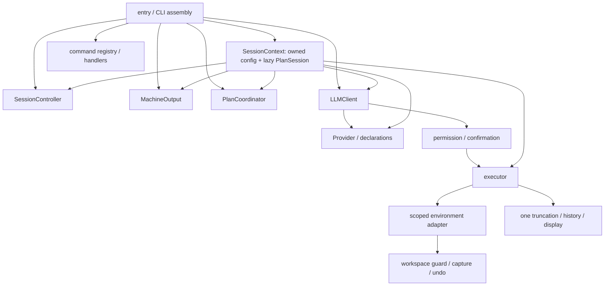

# 重构最终集成验收

## 阶段与交付

| 阶段 | 实际职责 | 本地验收与提交 |
| --- | --- | --- |
| R1 | 命令统一注册；工具声明/权限/执行/展示分工 | 3152项完整测试及全部门禁通过；b7d3ce4 |
| R2 | 会话/输出/计划协调服务；planning归拢与兼容入口 | 3173项完整测试及全部门禁通过；66db062 |
| R3 | 实例配置和唯一惰性计划状态；绑定声明/执行/回调/环境 | 独立审查、三版本完整矩阵及全部本地门禁通过，0bb6415 |

三阶段分别提交在chore/refactor-command-tools，最终统一PR到master。用户2026-11-27已授权自主实施全部重构；合并必须等待本次PR的CI通过并获得用户明确确认。未归档、未发布、未升版本。

## 实际调用链

配置在CLI组装处深复制一次，服务引用同一所属映射，计划模式从唯一计划引用派生。保存/检查点回调用无锁配置作用域；实际工具/undo才使用env锁，顺序env->workspace。CLI继续掌握交互、生成线程、确认和取消生命周期。默认兼容入口、自定义工具和provider差异保留。

## 验收映射

| 条件 | 证据 | 最终状态 |
| --- | --- | --- |
| A1 命令及工具入口 | R1固定命令契约、schema/provider差异、真实执行/消息/审计；R1 verification.md及最终完整矩阵 | 最终本地集成通过 |
| A2 明确服务依赖 | R2独立构造真实服务、旧数据/文件/线程、命令无私有状态读写；R2 verification.md及最终边界审查 | 最终本地集成通过 |
| A3 状态与配置隔离 | 旧源码真实污染失败；fresh新进程无reset及旧getter禁止；A/B/A声明/执行/回调/目录/脱敏 | R3独立完整验收通过 |
| A4 行为与数据兼容 | 原用例/断言保留、TTY/headless事件、确认取消、旧会话计划与检查点实际字节恢复 | 最终三版本完整套件通过 |
| A5 全范围质量 | 3.12完整测试、3.10/3.13实际矩阵、lint/格式/docs/build/包字节/原性能阈值 | 全部本地门禁通过，详见下表及R3记录 |
| A6 交付与回退 | 独立阶段提交、统一PR、规范与本调用链，按R3->R2->R1逆序回退 | 统一PR #60已创建；CI待完成，合并需用户明确确认 |

## 兼容边界

不新增配置、CLI命令、用户工具签名、依赖、存储格式或迁移步骤；保持轻量、通用和自定义目标。并发应用/cwd、跨实例undo/output-history所有权以及无关console/加载缓存单例不在本次范围。最终三版本与全部QA的实际日志写在R3 verification.md；组件测试有重叠，不累加为总数。

## 最终本地验收（2026-11-28）

| 检查 | 结果 |
| --- | --- |
| Python3.10.21 | 3195 passed，1 skipped，109.21秒；唯一跳过为既有tomllib标准库检查 |
| Python3.12.11 | 3196 passed，98.75秒 |
| Python3.13.18 | 3196 passed，107.16秒 |
| 静态与文档 | 全仓Ruff、85个改动py格式/isort/3.10AST、diff、strict docs全部通过 |
| 构建 | wheel/sdist通过，119个产品模块逐字节核对，wheel无tests |
| 冻结一致性 | 235个源/测试文件集合及SHA在全部矩阵和性能检查后保持一致 |
| 原性能门禁 | n=5，version/help/template/import/REPL/local oneshot六项全部通过，脚本和阈值未改 |

独立最终checker未发现新阻塞。完整S3-A1—A6及父A1—A6证据映射见本机/tmp/yaicli-s3-final-acceptance.json，持久化摘要见第三阶段verification.md；临时日志不是长期依赖。三个阶段已提交b7d3ce4、66db062、0bb6415并推送，统一PR为[#60](https://github.com/belingud/yaicli/pull/60)，目标master。A6剩余交付事项为远端最新head CI及用户明确合并确认；未合并、不提前归档。

## 用户后续报告的独立渲染缺陷（2026-11-28）

原三阶段验收/PR7408c51的CI通过后，用户报告含☀️的流式回答残留重复。结合已授权读取的debug生命周期日志与真实Rich输出，定位到旧锁Rich14.0.0的VS16计宽缺陷；重构前同样存在。已建立独立任务[stream-emoji-rendering](../11-28-stream-emoji-rendering/prd.md)，以独立fix提交附加到同一PR60，不重写原阶段提交或把升级前门禁冒称升级后验证。其192项聚焦与26组独立重放已绿，完整验收/最新PR CI由该任务继续；合并仍需用户明确确认。

### 缺陷跟进本地验收完成

独立stream-emoji-rendering任务已完成定向Rich14.3.3修复和本地独立检查：旧版4项VS16红灯，修复后10项回归与26组重放通过（108次残留→1次）；真实天气fake工具在工作线程只执行一次，debug前后TTY字节相同。冻结245文件未变，3203项通过后因沙箱回环端口限制产生的3项准备错误同hash补跑通过，共3206个不同测试已验证。静态、strict docs、离线lock/构建、原启动门禁均通过；新版wheel/sdist120产品文件与源码一致。本段不替代上文三阶段历史基线；完整结果见../11-28-stream-emoji-rendering/verification.md及acceptance.json。待单独fix提交和最新head CI，再等待用户明确合并确认。

## 最终合并与归档（2026-11-28）

最新交付head 5d2424bb8e0288625c851ad72a83734a4052b604 的六项CI全部通过：Python3.10/3.12/3.13完整测试、Lint & docs、Cold-start gate、GitGuardian。用户明确回复“好，合并吧”后，PR60于2026-11-28 06:02:54 UTC（北京时间14:02:54）以merge commit ae8620af6cfa0c084e68c37d88405a30a4ba5bc5合并到master。本地master已快进同步，原有无关未提交改动保留。长期合并/CI证据见delivery.json。

本PR对应父任务、三个重构阶段及独立emoji修复均已完成；按仓库规则归档到archive/2026-11，不开展新功能，不发布、不升版本。此前章节中的“待CI/合并”等为当时历史状态，以本节为最终交付结果。后续仅允许任务归档与会话记录的bookkeeping提交。
