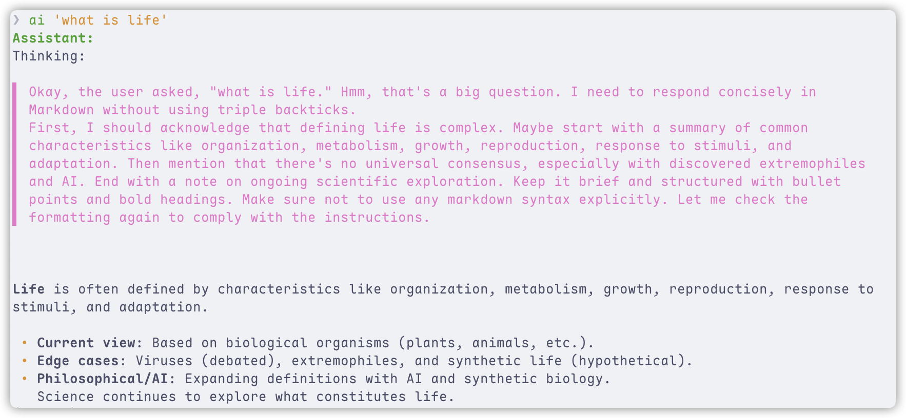
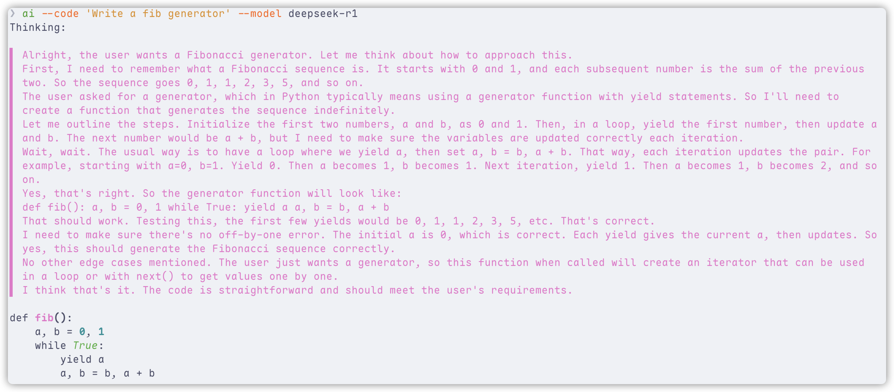
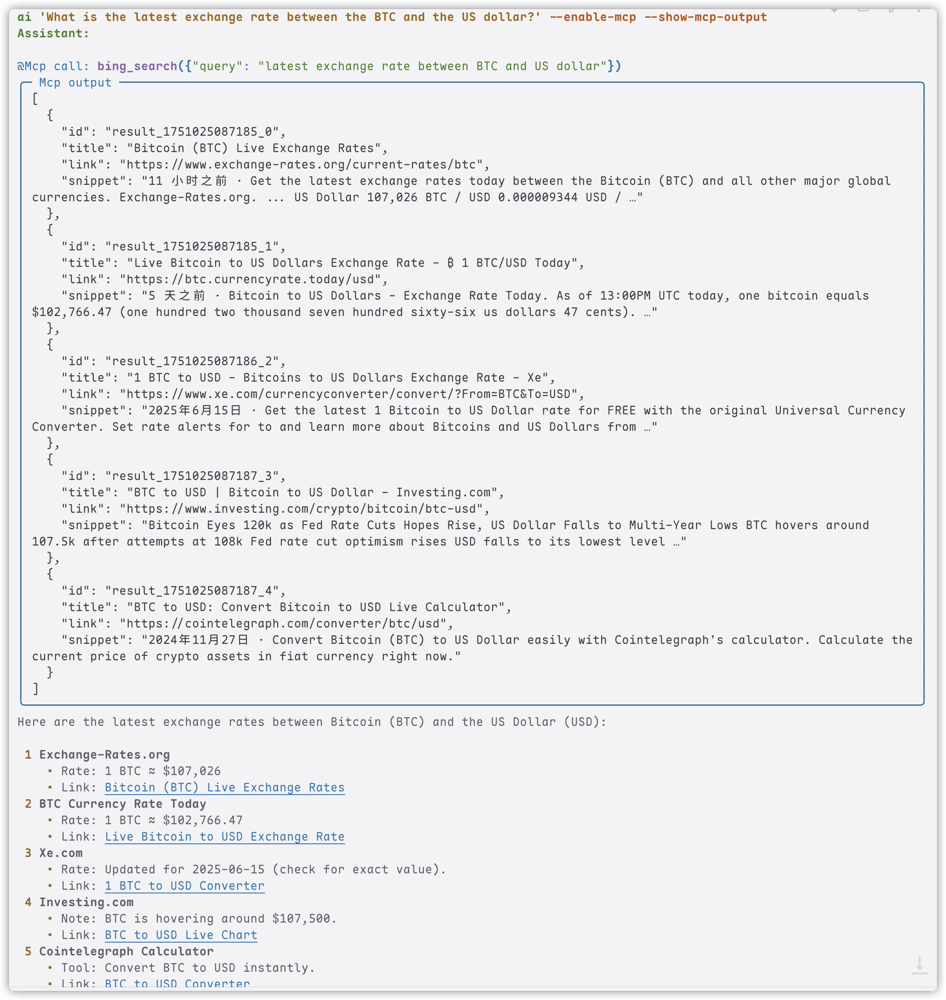

# YAICLI: Your AI assistant in command line.

<p align="center">
  
</p>

<a href="https://www.producthunt.com/posts/yaicli?embed=true&utm_source=badge-featured&utm_medium=badge&utm_source=badge-yaicli" target="_blank"></a>

[](https://pypi.org/project/yaicli/)


YAICLI is a powerful yet lightweight command-line AI assistant that brings the capabilities of Large Language Models (
LLMs) like GPT-5 directly to your terminal. Interact with AI through multiple modes: have natural conversations,
generate and execute shell commands, or get quick answers without leaving your workflow.

- **Tools out of the box** — 12 built-in tools load straight from the installed package; there is
  no install step before the model can use them.
- **Safe by default** — every tool call is confirmed before it runs, shell commands are
  risk-classified, every decision is written to an audit log, and file writes stay inside the
  workspace with backups + `/undo`.
- **Scriptable** — `-p/--print`, `--output-format json|stream-json`, stdin piping, documented exit
  codes, and clean stdout/stderr separation make it usable in scripts and CI.
- **Lightweight, with numbers** — startup, install size and memory are measured (see *Lightweight &
  scope* below); no background processes.
- **Any provider** — OpenAI, Anthropic, Gemini, Ollama and 30+ more through the Compatibility layer.

**Supports both standard and deep reasoning models across all major LLM providers.**

<a href="https://asciinema.org/a/vyreM0n576GjGL2asjI3QzUIY" target="_blank"></a>

> [!NOTE]
> YAICLI is actively developed. While core functionality is stable, some features may evolve in future releases.

> We support MCP since v0.7.0!
>
> We support Function Call since v0.5.0!

## ⚡ Agent Quick Start (3 steps)

**1. Install and give it a key** (~30 seconds)

```bash
pip install yaicli

# either export a key for the default OpenAI provider ...
export YAI_API_KEY="sk-..."
# ... or run a real command once (e.g. `ai "hi"`) and edit ~/.config/yaicli/config.ini
ai --version
```

**2. Give the agent a real task** (~1 minute)

```bash
ai "Use your tools to find the 3 largest files in this repository and write a summary to REPORT.md"
```

The model picks the built-in tools it needs (`fs_list_directory`, `fs_read_file`, `fs_write_file`,
`execute_shell_command`, ...), reads each result, and continues until the task is done. There is no
`--install-functions` step — the built-in tools are loaded directly from the package.

**3. Approve tool calls** (the one safety rule you need)

```
╭─ Confirm tool call ─────────────────────────────────────╮
│ execute_shell_command({"shell_command": "du -sh ."})    │
╰─────────────────────────────────────────────────────────╯
Execute tool? [y]once, [a]session, [A]always, [n]o:
```

| Key | Meaning |
|-----|---------|
| `y` | Allow this call only |
| `a` | Allow this tool for the rest of the session |
| `A` | Always allow — saved to `~/.config/yaicli/tool_permissions.json` |
| `n` | Deny — the model receives a refusal and adapts its plan |

Read-level tools can be auto-approved in scripts; write/execute-level tools still require an
explicit rule. See [Permissions & Safety](docs/usage/permissions.md) for rules, audit log and
headless approval flags.

**Next:** [script it](docs/usage/headless.md) · [long-context behaviour](docs/usage/context-limits.md)
· [upgrade notes](docs/advanced/upgrade.md) · [all command-line options](docs/usage/commands.md)

## ✨ Key Features

### 🤖 Agent Loop with Built-in Tools

- **Multi-step tasks**: the model plans, calls tools, reads results and continues — no manual
  copy-paste between steps
- **12 built-in tools**: filesystem read/write/edit/search/info, image reading,
  shell execution, web fetch, web search and weather
- **Project-aware**: `.yaicli.md` / `AGENTS.md` / `CLAUDE.md` from the repository are loaded into the
  system prompt automatically — see [Project Context](docs/usage/project-context.md)
- **MCP (optional)**: connect external MCP servers as additional tools
- **Bounded**: tool-call depth, token budget and per-tool output limits keep long tasks under
  control

### 🛡️ Safe by Default

- **Approval prompt** for every tool call — allow once, for the session, permanently, or deny
- **Risk classes** (`read` / `write` / `network` / `exec`) and danger classification for shell
  commands (`rm -r -f`, `mkfs`, `dd of=/dev/*`, `curl … | sh`, ...)
- **Allow rules** in `tool_permissions.json` — per tool name, shell argv prefix, or file path glob
- **Audit log** of every tool decision in `tool_audit.jsonl`
- **Workspace-confined writes**: built-in file tools only change files inside `WORKSPACE_ROOT`,
  back up existing files to `.yaicli-backups/`, refuse protected paths (`.git/`, `.env*`, ...), and
  `/undo` reverts the last change — see [Workspace Safety](docs/usage/workspace-safety.md)
- **Guarded shell**: timeout, process-group kill, filtered environment (no API keys leaked to
  commands), workspace-confined `cwd`

### 📜 Headless & Scriptable

- **`-p/--print`** for explicit one-shot runs, **`-q/--quiet`** for answer-only output
- **`--output-format json|stream-json`** — one JSON object, or one NDJSON event per line
- **stdout only carries the result**; labels, warnings and errors go to stderr
- **Deterministic exit codes** (`0/1/2/3/130/141`) and SIGINT/EPIPE handling
- **Non-interactive approvals** with `--yes`, `--allowed-tools` and `--fail-on-tool-denied`

### 🧠 Context Economy

- **Tool-output truncation** with full output spilled to disk (head+tail kept, model can page it
  back with `fs_read_file`)
- **Token budget** (`CONTEXT_BUDGET_TOKENS`) and turn-group-aligned history trimming — a
  `tool_calls` message is never separated from its tool results
- **Self-healing**: a provider `context_length` error is retried once after trimming instead of
  failing permanently
- **`/context`** shows what occupies the window, **`/compact [keep_rounds]`** compresses it on demand

### 🔄 Multiple Interaction Modes

- **💬 Chat Mode**: Engage in persistent conversations with full context tracking
- **🚀 Execute Mode**: Generate and safely run OS-specific shell commands
- **⚡ Quick Query**: Get instant answers without entering interactive mode

### 💻 Enhanced Terminal Experience

- **Real-time Streaming**: See responses as they're generated with cursor animation
- **Rich History Management**: Manage histories with 500 entries by default
- **Syntax Highlighting**: Beautiful code formatting with customizable themes

### 🖼️ Image Input (Vision)

- **Local Images**: Pass local image files with `--image/-i` (JPEG, PNG, GIF, WebP)
- **URL Images**: Pass image URLs directly to vision-capable models
- **Multi-Image**: Specify `--image` multiple times for comparison tasks

### 🛠️ Developer-Friendly

- **Layered Configuration**: Environment variables > Config file > Sensible defaults
- **Any endpoint**: Works with any OpenAI-compatible API endpoint
- **Debugging Tools**: Verbose mode with detailed API tracing



Full document: https://belingud.github.io/yaicli/

## 🪶 Lightweight & scope

YAICLI stays small on purpose: one `pip install`, no daemon, no background process, no vector
index. The numbers below were measured on the same macOS sandbox across the v0.19 fast path and the
v0.20 startup/packaging work.

| Metric (baseline = v0.18, macOS sandbox) | Value |
| --- | --- |
| `ai --version` startup (P50) | ≈474–504 ms baseline → **≈40–45 ms** (v0.19 fast path) |
| `--help` startup (P50) | ≈519–568 ms baseline → **≈450–500 ms** after the v0.20 lazy-import work (the CLI stack is no longer imported for help) |
| one-shot local overhead (`ai "hi"`, no network) | ≈1.5–1.6 s baseline → **≈1.6 s** in the same sandbox; prompt_toolkit is no longer imported, provider-SDK init (≈0.9 s) still dominates |
| REPL ready (first prompt) | ≈1.55–1.75 s baseline → **≈0.55–0.65 s** (the LLM client/SDK is constructed on the first request) |
| base install closure | **95 dists** (v0.19.1: 103): fetch/search/MCP stay in base, the boto3/botocore/google-auth cloud closure (~25–29 MB) is now opt-in via `[bedrock]`/`[vertex]` |
| idle RSS | ≈30 MB for `--version`; ≈65 MB for a REPL with the OpenAI SDK loaded |
| background processes / daemons | **none** |

> **Measurement caveat:** these numbers were measured on macOS inside a sandboxed benchmark
> environment, where file access is intercepted and absolute timings are inflated (expect 2–3×
> slower than a bare machine). Treat the *relative* deltas and proportions as the credible claim;
> absolute milliseconds will be re-measured on CI before they are used in release notes. The full
> benchmark method and per-import breakdown are kept with the release engineering notes.

## 📦 Installation

### Prerequisites

- Python 3.10 or higher

### Quick Install

```bash
# Using pip (recommended for most users)
pip install yaicli

# Using pipx (isolated environment)
pipx install yaicli

# Using uv (faster installation)
uv tool install yaicli
```

A plain `pip install yaicli` is **tools-complete**: all 12 builtin tools (including `web_search`
and `fetch_webpage` extraction) and MCP work with no extra steps. Optional extras are only needed for
cloud/long-tail provider SDKs.

```shell
# install all optional dependencies
pip install 'yaicli[all]'

# install with specific provider support
pip install 'yaicli[ollama,cohere,doubao,huggingface,gemini,mistral,cerebras,fireworks]'
```

Install with `uv`:

```shell
# install all optional dependencies
uv tool install 'yaicli[all]'

# install with specific provider support
uv tool install 'yaicli[ollama,cohere,doubao,huggingface,gemini,mistral,cerebras,fireworks]'
```

Anthropic's API is part of the core dependencies and needs no extra. **Anthropic Bedrock** and
**Anthropic Vertex** need the cloud SDK closure: `pip install 'yaicli[bedrock]'` or
`pip install 'yaicli[vertex]'` (both are always included in `yaicli[all]`).

### Install from Source

```bash
git clone https://github.com/belingud/yaicli.git
cd yaicli
pip install .
```

## 🔌 Compatibility

Provider support is a compatibility layer, not the headline: YAICLI exposes one agent loop, and you
can point it at any of these providers (or any OpenAI-compatible endpoint) by changing `PROVIDER` /
`API_KEY` / `MODEL`.

- AI21
- Anthropic/Claude
- Anthropic Bedrock
- Anthropic Vertex
- Bailian
- Bailian International
- Cerebras
- ChatGLM
- Chutes
- Cohere
- Cohere Bedrock
- Cohere SageMaker
- DeepSeek
- Doubao
- Fireworks
- Gemini
- Groq
- HuggingFace
- Infini-AI
- LongCat
- LongCat (Anthropic format)
- MiniMax
- Mistral
- ModelScope
- Moonshot
- NVIDIA NIM
- Ollama
- OpenAI
- OpenAI Azure
- OpenRouter
- SambaNova
- SiliconFlow
- Spark
- Targon
- Together
- Vertex AI
- xAI

Any other OpenAI-compatible endpoint can be used with the `openai` or `openai-compatible`
provider plus a custom `BASE_URL`. See the [provider overview](docs/providers/overview.md) for
per-provider setup and the full configuration matrix.

## ⚙️ Configuration

YAICLI uses a simple configuration file to store your preferences and API keys.

### First-time Setup

1. Run a real command once (e.g. `ai "hi"`); the default configuration file is created on first
   use. Or export `YAI_API_KEY` and skip the file entirely.
2. Edit the config file to add your API key and customize settings.
3. Customize other settings as needed.

Plain `ai` with no prompt only prints help; it does not create the config file.

The configuration directory is resolved in this order: `YAI_CONFIG_DIR` →
`XDG_CONFIG_HOME/yaicli` → `%APPDATA%/yaicli` (Windows) → `~/.config/yaicli`. The file is created
with mode `0600` because it may contain API keys; exported environment variables are the preferred
way to keep keys out of disk.

### Configuration File Structure

The default configuration file is `config.ini` inside the config directory above. You can use
`ai --template` to see the default configuration template.

### Configuration Options Reference

| Option                 | Description                                 | Default                  | Env Variable               |
| ---------------------- | ------------------------------------------- | ------------------------ | -------------------------- |
| `PROVIDER`             | LLM provider (openai, anthropic, cohere, etc.) | `openai`              | `YAI_PROVIDER`             |
| `BASE_URL`             | API endpoint URL                            | -                        | `YAI_BASE_URL`             |
| `API_KEY`              | Your API key                                | -                        | `YAI_API_KEY`              |
| `MODEL`                | LLM model to use                            | `gpt-5.2`                | `YAI_MODEL`                |
| `DEFAULT_ROLE`         | Default role                                | `DEFAULT`                | `YAI_DEFAULT_ROLE`         |
| `SHELL_NAME`           | Shell type                                  | `auto`                   | `YAI_SHELL_NAME`           |
| `OS_NAME`              | Operating system                            | `auto`                   | `YAI_OS_NAME`              |
| `STREAM`               | Enable streaming                            | `true`                   | `YAI_STREAM`               |
| `TIMEOUT`              | API timeout (seconds)                       | `60`                     | `YAI_TIMEOUT`              |
| `EXTRA_HEADERS`        | Extra headers                               | -                        | `YAI_EXTRA_HEADERS`        |
| `EXTRA_BODY`           | Extra body                                  | -                        | `YAI_EXTRA_BODY`           |
| `REASONING_EFFORT`     | Reasoning effort                            | -                        | `YAI_REASONING_EFFORT`     |
| `DISABLE_PARALLEL_TOOL_USE` | Anthropic: send `disable_parallel_tool_use` (`true` = one tool call per response; `false` = allow parallel calls) | `true` | `YAI_DISABLE_PARALLEL_TOOL_USE` |
| `INTERACTIVE_ROUND`    | Chat turns kept in the REPL (×2 messages)   | `25`                     | `YAI_INTERACTIVE_ROUND`    |
| `CODE_THEME`           | Syntax highlighting theme                   | `monokai`                | `YAI_CODE_THEME`           |
| `TEMPERATURE`          | Response randomness                         | `0.3`                    | `YAI_TEMPERATURE`          |
| `FREQUENCY_PENALTY`    | Frequency penalty                           | `0.0`                    | `YAI_FREQUENCY_PENALTY`    |
| `TOP_P`                | Top-p sampling                              | `1.0`                    | `YAI_TOP_P`                |
| `MAX_TOKENS`           | Max response tokens                         | `1024`                   | `YAI_MAX_TOKENS`           |
| `MAX_HISTORY`          | Max history entries                         | `500`                    | `YAI_MAX_HISTORY`          |
| `AUTO_SUGGEST`         | Enable history suggestions                  | `true`                   | `YAI_AUTO_SUGGEST`         |
| `SHOW_REASONING`       | Enable reasoning display                    | `true`                   | `YAI_SHOW_REASONING`       |
| `JUSTIFY`              | Text alignment                              | `default`                | `YAI_JUSTIFY`              |
| `CHAT_HISTORY_DIR`     | Explicit session-directory override (old flat layout); a value equal to the built-in default means the per-project store | *unset* (per-project `~/.yaicli/sessions/<hash>/`) | `YAI_CHAT_HISTORY_DIR` |
| `MAX_SAVED_CHATS`      | Max saved sessions per store                | `20`                     | `YAI_MAX_SAVED_CHATS`      |
| `ROLE_MODIFY_WARNING`  | Warn when modifying built-in roles          | `true`                   | `YAI_ROLE_MODIFY_WARNING`  |
| `ENABLE_FUNCTIONS`     | Enable function calling                     | `true`                   | `YAI_ENABLE_FUNCTIONS`     |
| `SHOW_FUNCTION_OUTPUT` | Show function output when calling function  | `true`                   | `YAI_SHOW_FUNCTION_OUTPUT` |
| `ENABLED_TOOLS`        | Comma-separated tool-name globs offered to the model (`fnmatch`; MCP names keep the `_mcp__` prefix; empty = all tools) | - | `YAI_ENABLED_TOOLS` |
| `ENABLE_MCP`           | Enable MCP tools                            | `false`                  | `YAI_ENABLE_MCP`           |
| `SHOW_MCP_OUTPUT`      | Show MCP output when calling mcp            | `false`                  | `YAI_SHOW_MCP_OUTPUT`      |
| `MCP_TIMEOUT`          | Seconds one MCP list/call operation may take (`0` = no timeout) | `30` | `YAI_MCP_TIMEOUT` |
| `MCP_MAX_TOOLS`        | Max MCP tools offered to the model per request (`0` = unlimited) | `64` | `YAI_MCP_MAX_TOOLS` |
| `SHOW_USAGE`           | Print one token/cost line after each interactive turn | `true`          | `YAI_SHOW_USAGE`           |
| `MODEL_PRICING`        | JSON price overrides: `{"model-prefix": {"input": 2.5, "output": 10}}` (USD per 1M tokens) | - | `YAI_MODEL_PRICING` |
| `MAX_TOOL_CALL_DEPTH`  | Max tool calls in one request               | `8`                      | `YAI_MAX_TOOL_CALL_DEPTH`  |
| `TOOL_CONFIRM`         | Confirm each tool call before running it    | `true`                   | `YAI_TOOL_CONFIRM`         |
| `TOOL_POLICY`          | Session-wide tool permission mode: `readonly`, `standard` or `trusted` | `standard` | `YAI_TOOL_POLICY` |
| `TOOL_OUTPUT_MAX_CHARS` | Max characters of one tool result kept in context (`0` = unlimited) | `32000` | `YAI_TOOL_OUTPUT_MAX_CHARS` |
| `TOOL_OUTPUT_DIR`      | Where full (untruncated) tool outputs are saved | `<tempdir>/yaicli/chats/tool-outputs` | `YAI_TOOL_OUTPUT_DIR` |
| `REDACT_SECRETS`       | Redact known secret shapes before tool output/sessions are written to disk | `true` | `YAI_REDACT_SECRETS` |
| `TOOL_DISPLAY_MAX_LINES` | Terminal preview: max lines of one tool result shown (`0` = unlimited) | `15` | `YAI_TOOL_DISPLAY_MAX_LINES` |
| `TOOL_DISPLAY_MAX_CHARS` | Terminal preview: max characters shown; the model cap is `TOOL_OUTPUT_MAX_CHARS` | `4000` | `YAI_TOOL_DISPLAY_MAX_CHARS` |
| `TOOL_CALL_PREVIEW_MAX_CHARS` | Max characters of the `@Function call:` argument line (`0` = raw) | `300` | `YAI_TOOL_CALL_PREVIEW_MAX_CHARS` |
| `ENABLE_PROJECT_CONTEXT` | Auto-load project instruction files into the system prompt (`false` = no project-file reads) | `true` | `YAI_ENABLE_PROJECT_CONTEXT` |
| `PROJECT_CONTEXT_MAX_CHARS` | Max characters of project context added to the system prompt (`0` = no cap) | `20000` | `YAI_PROJECT_CONTEXT_MAX_CHARS` |
| `CONTEXT_BUDGET_TOKENS` | Token budget per request (`0` = 70% of the model window) | `0`         | `YAI_CONTEXT_BUDGET_TOKENS` |
| `TOOL_TIMEOUT`         | Max seconds a shell tool command may run    | `120`                    | `YAI_TOOL_TIMEOUT`         |
| `TOOL_ENV_INHERIT`     | Pass the full parent environment to shell tools (old behaviour) | `false` | `YAI_TOOL_ENV_INHERIT` |
| `WORKSPACE_ROOT`       | Directory shell tools are confined to (empty = current dir) | -         | `YAI_WORKSPACE_ROOT`       |
| `RETRY_ENABLED`        | Retry retryable API failures (429/5xx/network/timeout) | `true`         | `YAI_RETRY_ENABLED`        |
| `RETRY_MAX`            | Maximum retry attempts                      | `2`                      | `YAI_RETRY_MAX`            |
| `RETRY_BASE_DELAY`     | Base backoff delay in seconds               | `1.0`                    | `YAI_RETRY_BASE_DELAY`     |
| `RETRY_MAX_DELAY`      | Maximum backoff delay in seconds (cap)      | `8.0`                    | `YAI_RETRY_MAX_DELAY`      |
| `EXIT_ON_DEPTH_LIMIT`  | Exit non-zero in one-shot mode when the tool-round limit is reached | `true` | `YAI_EXIT_ON_DEPTH_LIMIT` |
| `TOOL_AUDIT`           | Write tool decisions to `tool_audit.jsonl`  | `true`                   | `YAI_TOOL_AUDIT`           |
| `EXCLUDE_PARAMS`       | Comma-separated API parameters to omit       | -                        | `YAI_EXCLUDE_PARAMS`       |
| `MINIMAX_REASONING_SPLIT` | MiniMax interleaved reasoning (reasoning_split) | `true`            | `YAI_MINIMAX_REASONING_SPLIT` |

> **Tool execution confirmation:** With `TOOL_CONFIRM` enabled (the default), YAICLI asks before running each
> tool/function call. At the prompt you can allow it once, allow it for the rest of the session, allow it permanently,
> or deny it. Permanent approvals are stored per tool name in `tool_permissions.json`. Set
> `TOOL_CONFIRM=false` (or `YAI_TOOL_CONFIRM=false`) to run tool calls silently, as in previous versions. In
> non-interactive sessions (e.g. piped input) only tools already in the permissions file (or passed via
> `--allowed-tools`) run; others are denied. See [Permissions & Safety](docs/usage/permissions.md) for the
> rule format, risk levels, audit log and headless approval flags.

### LLM Provider Configuration

YAICLI works with major LLM providers. The default configuration is set up for OpenAI, but you can easily switch to
other providers.

Note: blank `BASE_URL` (or no `BASE_URL`) means use provider default url.

#### Pre-configured Provider Settings

| Provider                       | BASE_URL                                                  |
| ------------------------------ | --------------------------------------------------------- |
| **OpenAI** (default)           | `https://api.openai.com/v1`                               |
| **Anthropic/Claude**           | `https://api.anthropic.com`                               |
| **Cohere**                     | `https://api.cohere.com/v2`                               |
| **Gemini**                     | `https://generativelanguage.googleapis.com/v1beta`        |

> **Note**: Many providers offer OpenAI-compatible endpoints that work with the default settings.
>
> - Google Gemini: https://ai.google.dev/gemini-api/docs/openai
> - Claude: https://docs.anthropic.com/en/api/openai-sdk

If you not sure about base_url or just use the default provider base_url, just leave it blank or delete `BASE_URL`.

```ini
[core]
PROVIDER=cohere
BASE_URL=
API_KEY=xxx
MODEL=command-r-plus
```

#### Openai

Yaicli use `openai` as provider as default provider, `gpt-5.2` as default model, you can add your api key to use as it is.

```ini
PROVIDER=openai
BASE_URL=
API_KEY=
MODEL=gpt-5.2
```

Extra params:

```ini
# REASONING_EFFORT: [low, medium, high] (provider-specific)
REASONING_EFFORT=
```

See official for more details: https://platform.openai.com/docs/guides/reasoning?api-mode=chat

#### Openai Azure

```ini
PROVIDER=openai-azure
BASE_URL=
API_KEY=
MODEL=gpt-5.2
```

Support config keys:

```ini
AZURE_AD_TOKEN=
AZURE_ENDPOINT=
AZURE_DEPLOYMENT=
API_VERSION=
```

Support environment variables:

```shell
AZURE_OPENAI_API_KEY=
AZURE_OPENAI_AD_TOKEN=
AZURE_OPENAI_ENDPOINT=
```

If `API_KEY` not set in config, will look for `AZURE_OPENAI_API_KEY` environment variable.

If `AZURE_AD_TOKEN` not set in config, will look for `AZURE_OPENAI_AD_TOKEN` environment variable.

If `BASE_URL` and `AZURE_ENDPOINT` not set in config, will look for `AZURE_OPENAI_ENDPOINT` environment variable.

#### Anthropic/Claude

```ini
PROVIDER=anthropic
API_KEY=
MODEL=claude-sonnet-4-20250514
```

If you want to access **Anthropic bedrock**, install the extra first
(`pip install 'yaicli[bedrock]'`) and set `AWS_SECRET_ACCESS_KEY`, `AWS_ACCESS_KEY_ID`,
`AWS_SESSION_TOKEN` and `AWS_REGION` in config or environment variables.

```ini
PROVIDER=anthropic-bedrock
AWS_SECRET_ACCESS_KEY=
AWS_ACCESS_KEY_ID=
AWS_SESSION_TOKEN=
AWS_REGION=
MODEL=anthropic.claude-opus-4-20250514-v1:0
```

Support `ANTHROPIC_BEDROCK_BASE_URL` env or `BASE_URL` in config file, with same effect.

Also support **Anthropic vertex** (`pip install 'yaicli[vertex]'`) with key `PROJECT_ID` and
`CLOUD_ML_REGION` in config or environment variables.

```ini
PROVIDER=anthropic-vertex
PROJECT_ID=
CLOUD_ML_REGION=
```

You can set anthropic base url by `ANTHROPIC_VERTEX_BASE_URL` env, or set `BASE_URL` in config file, same effect.

#### Deepseek

```ini
PROVIDER=deepseek
API_KEY=
MODEL=deepseek-chat
```

Thinking mode can be controlled with the existing `EXTRA_BODY` and `REASONING_EFFORT` settings. DeepSeek enables
thinking by default for supported thinking models, so this is only needed when you want to be explicit or set effort:

```ini
PROVIDER=deepseek
API_KEY=
MODEL=deepseek-v4-pro
REASONING_EFFORT=high
EXTRA_BODY={"thinking":{"type":"enabled"}}
```

To disable thinking mode:

```ini
EXTRA_BODY={"thinking":{"type":"disabled"}}
```

When thinking mode is enabled, DeepSeek returns `reasoning_content`, which YAICLI displays as reasoning output and
preserves during live tool-call conversations. DeepSeek ignores `temperature`, `top_p`, `presence_penalty`, and
`frequency_penalty` while thinking is enabled.

#### OpenRouter

```ini
PROVIDER=openrouter
API_KEY=
MODEL=deepseek/deepseek-chat-v3-0324
```

#### Mistral

```ini
PROVIDER=mistral
API_KEY=
MODEL=codestral-latest
```

#### Gemini

Basic config:

```ini
PROVIDER=gemini
API_KEY=
MODEL=gemini-2.5-flash
```

Extra params:

```ini
TOP_K=
PRESENCE_PENALTY=
FREQUENCY_PENALTY=
SEED=
THINKING_BUDGET=
API_VERSION=
BASE_URL=
```

#### Vertex AI

```ini
PROVIDER=vertexai
MODEL=gemini-2.5-flash
PROJECT=
LOCATION=
```

#### Huggingface

Default `HF_PROVIDER` is `auto`.

```ini
HF_PROVIDER=auto
PROVIDER=huggingface
API_KEY=
MODEL=deepseek-ai/DeepSeek-R1-0528
```

See official docs for `HF_PROVIDER`: https://huggingface.co/docs/inference-providers/index

#### Groq

```ini
PROVIDER=groq
API_KEY=
MODEL=llama-3.3-70b-versatile
```

#### LongCat

```ini
PROVIDER=longcat
API_KEY=
MODEL=LongCat-Flash-Chat
BASE_URL=https://api.longcat.chat/openai
```

#### Moonshot

```ini
PROVIDER=moonshot
API_KEY=
MODEL=moonshot-v1-8k
```

See [Moonshot provider docs](docs/providers/moonshot.md).

#### XAI

```ini
PROVIDER=xai
API_KEY=
MODEL=grok-3
```

#### Minimax

```ini
PROVIDER=minimax
API_KEY=
MODEL=MiniMax-M2.1
```

Extra params:

```ini
# Enable/disable interleaved thinking (default: true)
MINIMAX_REASONING_SPLIT=true
```

MiniMax-M2.1 supports **Interleaved Thinking** - the model can reason before each tool use. When enabled, reasoning content is preserved in conversation history and displayed alongside responses.

#### Chatglm

```ini
PROVIDER=chatglm
API_KEY=
MODEL=glm-4-plus
```

Extra params:

Check offcial docs: https://bigmodel.cn/dev/api/normal-model/glm-4

```ini
# true or false
DO_SAMPLE=
```

#### Chutes

```ini
PROVIDER=chutes
API_KEY=
MODEL=deepseek-ai/DeepSeek-V3-0324
```

#### Cerebras

```ini
PROVIDER=cerebras
API_KEY=
MODEL=llama3.3-70b
```

#### AI21

```ini
PROVIDER=ai21
API_KEY=
MODEL=jamba-large-1.6
```

#### Sambanova

```ini
PROVIDER=sambanova
API_KEY=
MODEL=DeepSeek-V3-0324
```

Only a few models support tool call as below:

- Meta-Llama-3.1-8B-Instruct
- Meta-Llama-3.1-405B-Instruct
- Meta-Llama-3.3-70B-Instruct
- Llama-4-Scout-17B-16E-Instruct
- DeepSeek-V3-0324

See official docs for more detail: https://docs.sambanova.ai/cloud/docs/capabilities/function-calling

#### ModelScope

```ini
PROVIDER=modelscope
API_KEY=
MODEL=deepseek-ai/DeepSeek-V3-0324
```

#### Infini-AI

```ini
PROVIDER=infini-ai
; BASE_URL=https://cloud.infini-ai.com/maas/v1
API_KEY=
MODEL=deepseek-v3
```

#### Siliconflow

```ini
PROVIDER=siliconflow
API_KEY=
MODEL=Qwen/Qwen3-32B
```

#### Cohere

You have to install cohere dependencies, `pip install 'yaicli[cohere]'`

```ini
PROVIDER=cohere
API_KEY=
MODEL=command-a-03-2025
```

Check official docs: https://docs.cohere.com/docs/text-gen-quickstart

Support keys:

```ini
ENVIRONMENT=
```

For private deploy and Azure api, you need to set BASE_URL.

```ini
PROVIDER=cohere
API_KEY=
MODEL=command-a-03-2025
BASE_URL=<YOUR_ENDPOINT>
```

For Bedrock and Sagemaker cohere api, you have to set below keys:

See https://docs.cohere.com/docs/text-gen-quickstart.

```ini
PROVIDER=cohere-bedrock
; PROVIDER=cohere-sagemaker
API_KEY=
MODEL=command-a-03-2025

AWS_REGION=xx
AWS_ACCESS_KEY_ID=xx
AWS_SECRET_ACCESS_KEY=xx
AWS_SESSION_TOKEN=xx
```

Note `MODEL` for Sagemaker should be endpoint name

```ini
MODEL=<YOUR_ENDPOINT_NAME>
```

#### Doubao

You have to install doubao dependencies, `pip install 'yaicli[doubao]'`

Use doubao OpenAI compatible api, you can just set `API_KEY`.

```ini
PROVIDER=doubao
API_KEY=
MODEL=doubao-1-5-lite-32k-250115
```

If you are using access key, you have to set `AK` and `SK`.

```ini
PROVIDER=doubao
MODEL=doubao-1-5-lite-32k-250115
AK=XXX
SK=XXX
```

#### Ollama

You have to install ollama dependencies, `pip install 'yaicli[ollama]'`

```ini
PROVIDER=ollama
; BASE_URL=http://localhost:11434
MODEL=qwen3:32b
```

Support options:

```ini
TEMPERATURE=
TOP_P=
SEED=
NUM_PREDICT=
NUM_CTX=
NUM_BATCH=
NUM_GPU=
MAIN_GPU=
LOW_VRAM=
F16_KV=
LOGITS_ALL=
VOCAB_ONLY=
USE_MMAP=
USE_MLOCK=
NUM_THREAD=
```

NOTE: Ollama provider not support extra body

#### Bailian

> Only support model API call, not support application API call.

```ini
PROVIDER=bailian
API_KEY=
MODEL=qwen-plus
```

#### Bailian Intl

Bailian international platform.

```ini
PROVIDER=bailian-intl
API_KEY=
MODEL=qwen-plus
```

#### NVIDIA NIM

```ini
# the registered provider key is spelled "nvida" for historical reasons
PROVIDER=nvida
API_KEY=
MODEL=qwen/qwen3-235b-a22b
EXTRA_BODY={"chat_template_kwargs": {"thinking": false}}
```

> `chat_template_kwargs` is for Qwen3 and ibm/granite models; the example above disables thinking.

#### Together

Using together openai-compatible capabilities

```ini
PROVIDER=together
API_KEY=
MODEL=Qwen/Qwen3-235B-A22B-fp8-tput
```

#### Spark

Spark requires both `API_KEY` and `API_SECRET`; `APP_ID` is optional (sent as the request `uid`).

```ini
PROVIDER=spark
API_KEY=
API_SECRET=
APP_ID=
MODEL=4.0Ultra
```

## 🚀 Usage

### Common Commands

```bash
# Agent task: let the model pick and run tools
ai "Use your tools to find the 3 largest files here and write a summary to REPORT.md"

# Get a quick answer
ai "What is the capital of France?"

# Start an interactive chat session
ai --chat

# Generate and execute shell commands
ai --shell "Create a backup of my Documents folder"

# Generate code snippets, default in Python
ai --code "Write a Python function to sort a list"

# Analyze code from a file
cat app.py | ai "Explain what this code does"
# or use @
ai '@Justfile What does this file do'

# Scripting: one-shot, machine-readable output, answer only
ai -p "summarize the git log" --output-format json
ai -p "list open TODOs" --quiet

# Send an image to a vision model
ai --image photo.jpg "What is in this image?"

# Send multiple images
ai -i img1.png -i img2.png "Compare these two screenshots"

# Send an image URL
ai --image https://example.com/photo.jpg "Describe this"

# Debug with verbose mode
ai --verbose "Explain quantum computing"
```

### Interactive Mode Features

<table>
<tr>
<td width="50%">

**Commands**

- `/help|?` - Show help message
- `/clear` - Clear conversation history
- `/his` - Show chat history
- `/list` - List saved chats
- `/save <title>` - Save current chat with title
- `/load <index>` - Load a saved chat
- `/del <index>` - Delete a saved chat
- `/exit` - Exit the application
- `/mode chat|exec` - Switch modes
- `/add <path>` - Add file/dir to context
- `/context|/ctx` - Context usage and file context (list, add, remove, clear)
- `/compact [keep_rounds]` - Compress the conversation, keeping the last N turns
- `/permissions` - List/revoke tool approval rules
- `/show-output` - Open the full-screen tool-output viewer for this turn

**Keyboard Shortcuts**

- `Shift+Tab` - Toggle between Chat/Execute modes
- `Ctrl+C` - Clear the current input (during generation: cancel the turn); press twice quickly to exit
- `Ctrl+D` - Exit
- `Ctrl+R` - Search history
- `Ctrl+O` - Open the full-screen tool-output viewer (all outputs of this turn; also works while the
  assistant is generating — generation continues in the background and closing the viewer redraws
  the accumulated answer)
- `↑/↓` - Navigate through history

</td>
<td width="50%">

**Chat Mode** (💬)

- Natural conversations with context
- Markdown and code formatting
- Reasoning display for complex queries

**Execute Mode** (🚀)

- Generate shell commands from descriptions
- Review commands before execution
- Edit commands before running
- Safe execution with confirmation

</td>
</tr>
</table>

### Chat Persistent

The `<PROMPT>` parameter in chat mode is used as the session title. Since v0.21 sessions are saved per
project under `~/.yaicli/sessions/<sha256(resolved working directory)[:16]>/` (directories `0700`,
files `0600`), and each session records the model, provider, role and working directory it was
created with.

If `<PROMPT>` is not specified, the session is temporary and is not persisted; use `/save <title>`
to keep it. Running `ai --chat "<title>"` again loads that session from the current project's store;
if no session with that title exists, YAICLI prints an explicit notice and starts a new one.
`ai --resume` continues the newest session of the current project.

Sessions from the old temp directory are left in place and are not migrated automatically — see
[Chat Sessions & Resume](docs/usage/sessions.md).

```bash
$ ai --chat "meaning of life"
```

> !NOTE: Chat mode is not supported when you redirect input to `ai` command.
>
> ```bash
> $ cat error.log | ai --chat "Explain this error"
> ```
>
> The above command will be parsed as `ai "cat error.log | ai "Explain this error"`.

**Start a temporary chat session**

```bash
$ ai --chat
```

**Start a persistent chat session**

```bash
$ ai --chat "check disk usage"
```

**Load a saved chat session**

```bash
$ ai --chat hello
Chat title: hello

 ██    ██  █████  ██  ██████ ██      ██
  ██  ██  ██   ██ ██ ██      ██      ██
   ████   ███████ ██ ██      ██      ██
    ██    ██   ██ ██ ██      ██      ██
    ██    ██   ██ ██  ██████ ███████ ██

Welcome to YAICLI!
Current: Persistent Session: hello
Press Shift+Tab to switch mode
/clear             : Clear chat history
/his               : Show chat history
/list              : List saved chats
/save <title>      : Save current chat
/load <index>      : Load a saved chat
/del <index>       : Delete a saved chat
/exit|Ctrl+D       : Exit
Ctrl+C             : Clear input / cancel turn; press twice to exit
/mode chat|exec    : Switch mode (Case insensitive)
───────────────────────────────────────────────────────────────────────────────────────────────────────────────────────
 💬 > /his
Chat History:
1 User: hi
    Assistant:
    Hello! How can I assist you today?
───────────────────────────────────────────────────────────────────────────────────────────────────────────────────────
 💬 >
```

**Resume the newest session of this project**

```bash
$ ai --resume
Resumed session "check disk usage" (model=gpt-5.2, provider=openai, role=DEFAULT, messages=6)
```

### Image Input

Send images to vision-capable models (GPT-5.2, Claude 4.5, Gemini, Llama 4 Vision, etc.) directly from the CLI.

**Local image file**

```bash
ai --image photo.jpg "What is in this image?"
```

**Multiple images**

```bash
ai -i screenshot1.png -i screenshot2.png "Compare these two UIs"
```

**Image URL**

```bash
ai --image https://example.com/diagram.png "Explain this architecture diagram"
```

**Image without text prompt**

```bash
ai --image photo.jpg
```

When no prompt is given, YAICLI sends a minimal prompt (`Describe the image.`, or
`Describe these images.` for multiple images) with the image.

Supported formats: JPEG (`.jpg`, `.jpeg`), PNG (`.png`), GIF (`.gif`), WebP (`.webp`).

> **Note**: Image input is currently supported in single-shot mode only, not in interactive `--chat` mode. Providers without vision support (Cohere, HuggingFace, ChatGLM, ModelScope) will receive a warning and the images will be stripped.

### Input Methods

**Direct Input**

```bash
ai "What is the capital of France?"
```

**Piped Input**

```bash
echo "What is the capital of France?" | ai
```

**File Analysis**

```bash
cat demo.py | ai "Explain this code"
```

**Combined Input**

```bash
cat error.log | ai "Why am I getting these errors in my Python app?"
```

### File Context

YAICLI supports adding files and directories to the conversation context for better understanding of your codebase.

**Temporary @ References**

Use `@` to reference files in your query:

```bash
# Reference a single file
ai '@README.md What is this project about?'

# Reference multiple files
ai '@src/main.py @config.yaml Explain the architecture'

# Use quotes for paths with spaces
ai @"my document.txt" Summarize this
```

**Persistent Context**

Add files/directories to context for the entire session:

```bash
ai --chat
💬 > /add src/
💬 > /context list
# Shows all files in context

💬 > Explain the codebase structure
# AI can now see all files in src/

💬 > /context remove src/
💬 > /context clear
# Remove or clear context
```

**Features**

- Auto-completion: Type `@` and press `Tab` to browse files
- Smart ignores: Automatically skips `.git`, `node_modules`, `__pycache__`, etc.
- Directory support: Add entire directories (2-level depth by default)
- Path flexibility: Use relative or absolute paths

## 📱 Examples

### Quick Answer Mode

```bash
$ ai "What is the capital of France?"
Assistant:
The capital of France is Paris.
```

### Command Generation & Execution

```bash
$ ai -s 'Check the current directory size'
Assistant:
du -sh .
╭─ Command ─╮
│ du -sh .  │
╰───────────╯
Execute command? [e]dit, [y]es, [n]o (y): e
Edit command, press enter to execute:
du -sh ./
Output:
109M    ./
```

### Code Generation

In code mode, select the language for code generation. If none is specified, Python is the default.

The `--code` mode outputs plain text, making it easy to copy, paste, or redirect to a file, especially when using the standard model.

When using a deep reasoning model, the thinking content is displayed with syntax highlighting. To disable this, use the `--hide-reasoning` option or set `SHOW_REASONING` to `false` in the configuration.

```bash
$ ai --code 'Write a fib generator'
def fib_generator():
    a, b = 0, 1
    while True:
        yield a
        a, b = b, a + b
```

### Chat Mode Example

```bash
$ ai --chat
Starting a temporary chat session (will not be saved automatically)

 ██    ██  █████  ██  ██████ ██      ██
  ██  ██  ██   ██ ██ ██      ██      ██
   ████   ███████ ██ ██      ██      ██
    ██    ██   ██ ██ ██      ██      ██
    ██    ██   ██ ██  ██████ ███████ ██

Welcome to YAICLI!
Current: Temporary Session (use /save to make persistent)
Press Shift+Tab to switch mode
/clear             : Clear chat history
/his               : Show chat history
/list              : List saved chats
/save <title>      : Save current chat
/load <index>      : Load a saved chat
/del <index>       : Delete a saved chat
!<command>         : Execute shell command directly (e.g., !ls -al)
/exit|Ctrl+D       : Exit
Ctrl+C             : Clear input / cancel turn; press twice to exit
/mode chat|exec    : Switch mode (Case insensitive)
───────────────────────────────────────────────────────────────────────────────────────────────────────────────────────
 💬 > Tell me about the solar system

Assistant:
Solar System Overview

 • Central Star: The Sun (99% of system mass, nuclear fusion).
 • Planets: 8 total.
    • Terrestrial (rocky): Mercury, Venus, Earth, Mars.
    • Gas Giants: Jupiter, Saturn.
    • Ice Giants: Uranus, Neptune.
 • Moons: Over 200 (e.g., Earth: 1, Jupiter: 95).
 • Smaller Bodies:
    • Asteroids (between Mars/Venus), comets ( icy, distant), * dwarf planets* (Pluto, Ceres).
 • Oort Cloud: spherical shell of icy objects ~1–100,000天文單位 (AU) from Sun).
 • Heliosphere: Solar wind boundary protecting Earth from cosmic radiation.

Key Fact: Earth is the only confirmed habitable planet.

🚀 > Check the current directory size
Assistant:
du -sh .
╭─ Suggest Command ─╮
│ du -sh .          │
╰───────────────────╯
Execute command? [e]dit, [y]es, [n]o (y): e
Edit command: du -sh ./
--- Executing ---
 55M    ./
--- Finished ---
🚀 >
```

### Execute Mode Example

```bash
$ ai --shell "Find all PDF files in my Downloads folder"
Assistant:
find ~/Downloads -type f -name "*.pdf"
╭─ Suggest Command ───────────────────────╮
│ find ~/Downloads -type f -iname "*.pdf" │
╰─────────────────────────────────────────╯
Execute command? [e]dit, [y]es, [n]o (y): y
Output:

/Users/username/Downloads/document1.pdf
/Users/username/Downloads/report.pdf
...
```

### Code Mode Example

```bash
$ ai --code "write a fib generator" --model deepseek-r1
```



### Built-in Tools & Function Calling

Function calling is what makes YAICLI an agent: the model can ask YAICLI to run local tools such
as file readers, `web_search`, `fetch_webpage` and `execute_shell_command`, read the result, and
continue working. The 12 built-in tools are loaded directly from the installed package, so they
work immediately with no `--install-functions` step:

| Tool group | Built-in tools |
| --- | --- |
| Filesystem (read) | `fs_get_filesystem_info`, `fs_list_directory`, `fs_read_file`, `fs_read_image`, `fs_search_files` |
| Filesystem (write) | `fs_write_file`, `fs_edit_file`, `fs_file_operations` |
| Shell (exec) | `execute_shell_command` |
| Network | `fetch_webpage`, `web_search`, `get_weather` |

- Copy a built-in definition into `~/.config/yaicli/functions/` to edit it:
  `ai --install-functions` exports editable copies (existing files are kept), and a user copy
  overrides the built-in with the same tool name.
- `ai --list-functions` shows every loaded tool and whether it is `builtin` or `user`.
- `ai --reinstall-functions` refreshes stale copies after an upgrade (custom files are kept). This
  is only needed if you have exported copies in the functions directory.
- Function calling is enabled by default (`ENABLE_FUNCTIONS`); use `--enable-functions` /
  `--disable-functions` to toggle it per run, and `--hide-function-output` to hide tool output.
- Offer only the tools a task needs to shrink the per-request schema payload: `--tools
  'fs_*,web_search'` (or the persistent `ENABLED_TOOLS` config key). MCP tools are matched with
  their `_mcp__` prefix, e.g. `--tools '_mcp__github_*'`.

Every tool call asks for confirmation by default (`TOOL_CONFIRM`; allow once, for the session,
permanently, or deny); shell commands and writes get an extra risk check, and every decision is
recorded in the audit log. See [Permissions & Safety](docs/usage/permissions.md),
[Headless & Scripting](docs/usage/headless.md) and
[Advanced Usage — Function Calling](docs/usage/advanced.md#function-calling) for the full
command/flag reference and custom-function guide.

### MCP

Add your MCP config in `~/.config/yaicli/mcp.json` (`C:\Users\<user>\.config\yaicli\mcp.json` on Windows.).

`--enable-mcp` option is corresponds to the configuration key `ENABLE_MCP`.

Example:

```shell
ai 'What is the latest exchange rate between the BTC and the US dollar?' --enable-mcp --show-mcp-output

Assistant:

@Mcp call: bing_search({"query": "latest exchange rate between BTC and US dollar"})
╭─ Mcp output ──────────────────────────────────────────────────────────────────────────────────────────────────────────────╮
│ [                                                                                                                         │
│   {                                                                                                                       │
│     "id": "result_1751024997243_0",                                                                                       │
│     "title": "BTC to USD - Bitcoin to US Dollar Conversion - Exchange Rates",                                             │
│     "link": "https://www.exchange-rates.org/converter/btc-usd",                                                           │
│     "snippet": "11 小时之前 · 1 Bitcoin = 107,304 US Dollars as of June 27, 2025 03:00 AM UTC. You can get live exchange  │
│ rates between Bitcoin and US Dollars using exchange-rates.org, which aggregates …"                                        │
│   },                                                                                                                      │
╰───────────────────────────────────────────────────────────────────────────────────────────────────────────────────────────╯
Here are some current exchange rates for Bitcoin (BTC) to US Dollar (USD):

 1 Exchange-Rates.org:
   ₿1 Bitcoin = 💵107,304 US Dollars (as of June 27, 2025, 03:00 AM UTC).
   Link
 2 BTC.CurrencyRate.Today:
   Live Bitcoin to US Dollars exchange rate.
   Link
 3 Xe.com:
   Latest conversion rate and information about Bitcoin to US Dollars.
   Link
 4 BestExchangeRates.com:
   Current BTC to USD market data, including charts and historic rates.
   Link
 5 Investing.com:
   Bitcoin price analysis and live BTC to USD updates.
   Link

For the most accurate and up-to-date rate, I recommend checking one of these sources directly.
```



## 💻 Technical Details

### Architecture

YAICLI is designed with a modular architecture that separates concerns and makes the codebase maintainable:

- **CLI Module**: Handles user interaction and command parsing
- **API Client**: Manages communication with LLM providers
- **Config Manager**: Handles layered configuration
- **History Manager**: Maintains conversation history with LRU functionality
- **Printer**: Formats and displays responses with rich formatting

### Dependencies

| Library                                                         | Purpose                                            |
| --------------------------------------------------------------- | -------------------------------------------------- |
| [Typer](https://typer.tiangolo.com/)                            | Command-line interface with type hints             |
| [Rich](https://rich.readthedocs.io/)                            | Terminal formatting and beautiful display          |
| [prompt_toolkit](https://python-prompt-toolkit.readthedocs.io/) | Interactive input with history and auto-completion |
| [json-repair](https://github.com/mangiucugna/json_repair)       | Repair llm function call arguments                 |

## 👨‍💻 Contributing

Contributions are welcome! Here's how you can help:

- **Bug Reports**: Open an issue describing the bug and how to reproduce it
- **Feature Requests**: Suggest new features or improvements
- **Code Contributions**: Submit a PR with your changes
- **Documentation**: Help improve or translate the documentation

## 📃 License

[Apache License 2.0](LICENSE)

---

<p align="center"><i>YAICLI - Your AI Command Line Interface</i></p>
